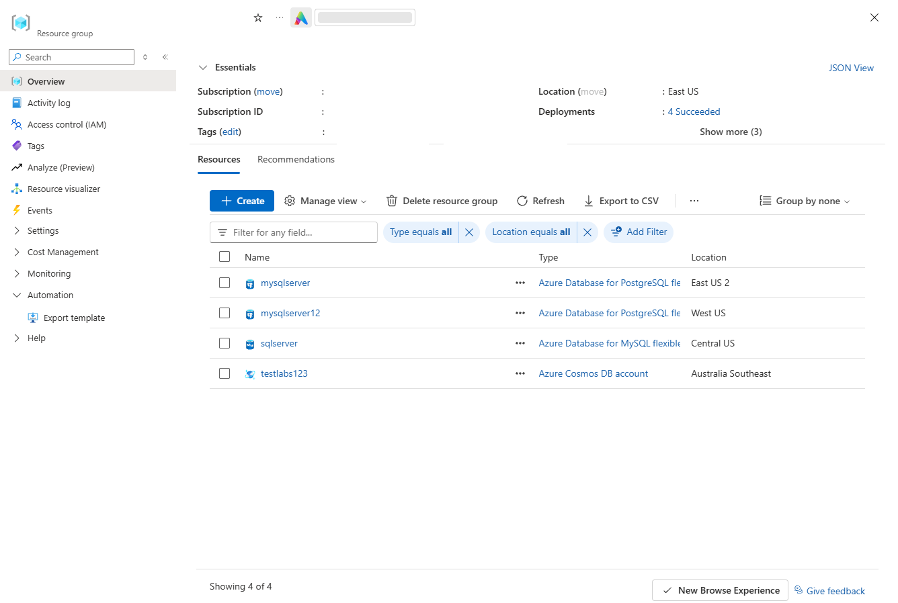
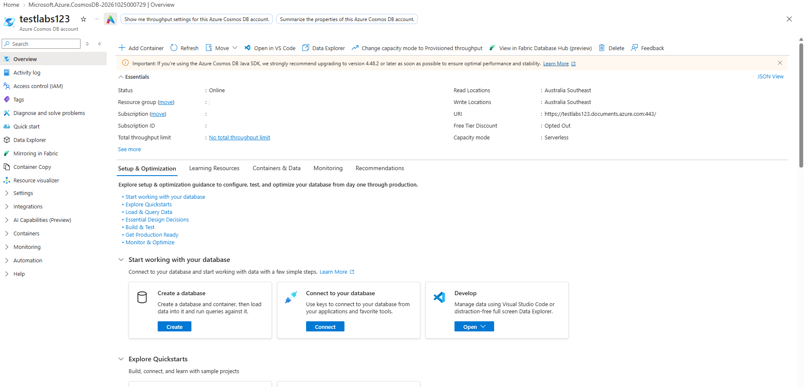
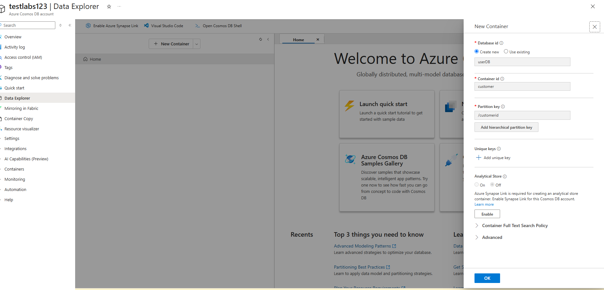
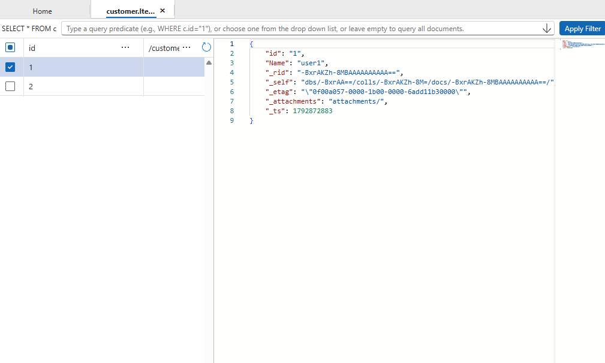
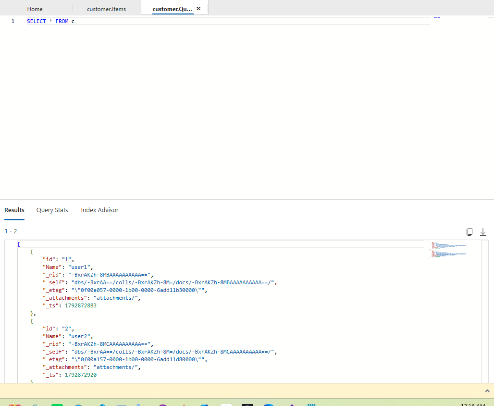
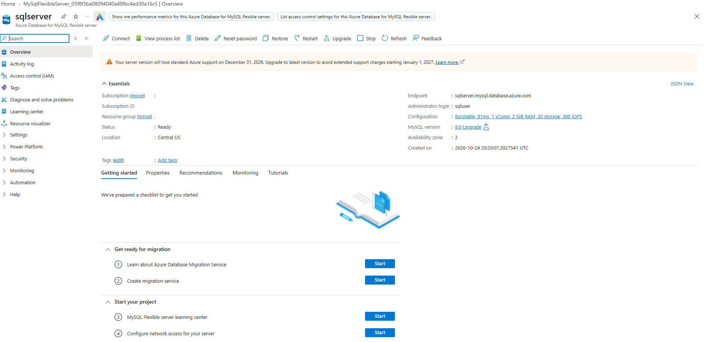
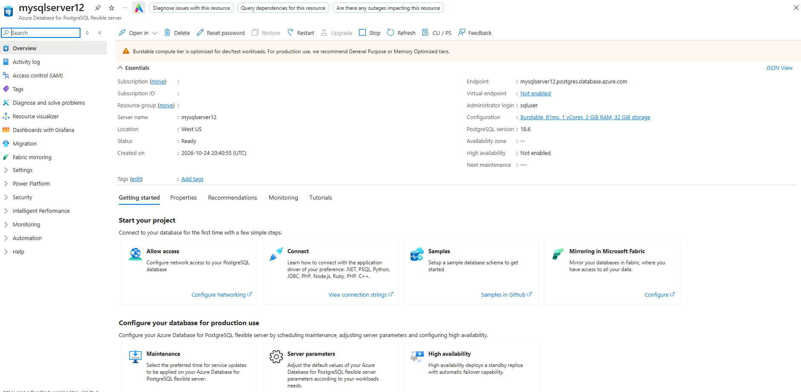
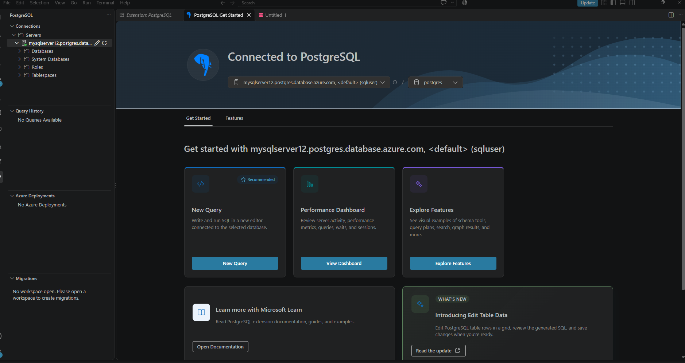

# Understanding Azure Database Services

Comprehensive Azure database services implementation demonstrating the deployment and exploration of Azure Cosmos DB, Azure Database for MySQL Flexible Server, and Azure Database for PostgreSQL Flexible Server. The lab included resource provisioning, database and container creation, connectivity validation using external tools, data insertion, and query execution across multiple Azure database platforms.

---

## 1. Architecture & Provisioned Resources

### Core Infrastructure Topology

| Resource Type | Resource Name | Specification / Purpose |
| :--- | :--- | :--- |
| **Azure Cosmos DB Account** | `testlabs123` | NoSQL database platform using serverless capacity mode |
| **Cosmos DB Database** | `userDB` | Logical database for document storage |
| **Cosmos DB Container** | `customer` | Container for storing JSON documents |
| **Azure Database for MySQL Flexible Server** | `sqlserver` | Managed MySQL database service |
| **Azure Database for PostgreSQL Flexible Server** | `mysqlserver12` | Managed PostgreSQL database service |
| **MySQL Workbench** | External Client | MySQL server connectivity testing |
| **Visual Studio Code PostgreSQL Extension** | External Client | PostgreSQL server connectivity testing |

---

### Provisioned Environment Validation

*Resource group inventory confirming successful deployment of Azure Cosmos DB, Azure Database for MySQL Flexible Server, and Azure Database for PostgreSQL Flexible Server.*

---

## 2. Azure Cosmos DB Implementation

### Step 1: Create Azure Cosmos DB Account

Provisioned an Azure Cosmos DB account using the serverless capacity model to provide scalable NoSQL database capabilities.

*Azure Cosmos DB account successfully deployed and ready for database and container creation.*

---

### Step 2: Create Database and Container

Created a Cosmos DB database named **userDB** and a container named **customer** with an appropriate partition key for document storage and scalability.

*Creation of the userDB database and customer container using the Azure Cosmos DB Data Explorer.*

---

### Step 3: Insert JSON Documents

Added sample JSON documents to the customer container to validate storage and document management functionality.

*Document successfully added to the customer container with unique identifiers and attributes.*

---

### Step 4: Execute Queries Against Cosmos DB

Executed SQL-like queries using Cosmos DB Data Explorer to retrieve stored JSON documents.

*Query execution successfully returned all available customer documents stored within the container.*

---

## 3. Azure Database for MySQL Flexible Server

### Step 1: Deploy MySQL Flexible Server

Provisioned an Azure Database for MySQL Flexible Server instance and verified successful deployment.

*Azure Database for MySQL Flexible Server successfully deployed and available for client connections.*

---

### Step 2: Validate Connectivity Using MySQL Workbench

Established a connection from MySQL Workbench to the Azure MySQL Flexible Server using the configured endpoint and administrative credentials.

*Successful database connection established via MySQL Workbench to the Azure Database for MySQL Flexible Server.*

---

## 4. Azure Database for PostgreSQL Flexible Server

### Step 1: Deploy PostgreSQL Flexible Server

Provisioned an Azure Database for PostgreSQL Flexible Server instance and verified successful deployment and availability.

*Azure Database for PostgreSQL Flexible Server successfully deployed and ready for database operations.*

---

### Step 2: Validate Connectivity Using Visual Studio Code

Connected to the PostgreSQL Flexible Server using the PostgreSQL extension in Visual Studio Code and verified successful access to server resources.

*Successful PostgreSQL connection established through Visual Studio Code with access to databases, roles, and server resources.*
